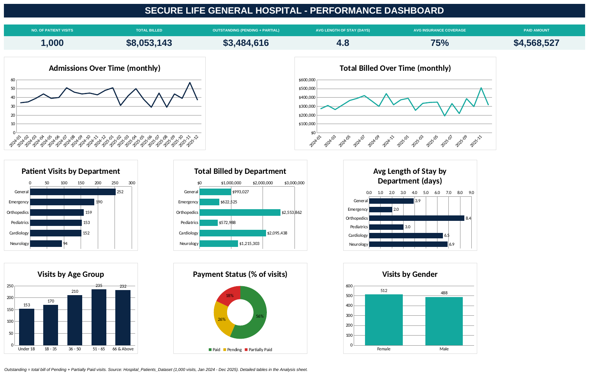

# SECURE LIFE GENERAL HOSPITAL - PERFORMANCE DASHBOARD

## Introduction
Secure Life General Hospital handles complex patient care across multiple departments. This project analyzes 1,000 patient records (January 2024 to December 2025) to evaluate hospital operations, department revenue, admission patterns, and payment collection efficiency.

## Executive Dashboard

## Key Performance Indicators
* **Total Patients Treated:** 1,000 visits
* **Total Billed Amount:** $8,053,143
* **Total Collected Revenue:** $4,568,527
* **Outstanding Revenue (Pending + Partial):** $3,484,616
* **Average Length of Stay:** 4.8 Days
* **Average Insurance Coverage:** 75%

## Key Analytical Insights
1. **Department Billing Concentration:** Orthopedics ($2.55M) and Cardiology ($2.10M) account for ~58% of total hospital billing, despite driving only 31% of visits.
2. **Operational Length of Stay:** Orthopedics (8.4 days), Neurology (6.9 days), and Cardiology (6.5 days) hold the longest recovery durations. Emergency admissions average the shortest at 2.0 days.
3. **Revenue Realization & Accounts Receivable:** 56.4% of visits are fully settled, while 43.3% of total billed revenue remains outstanding across pending and partially paid accounts.
4. **Demographics:** The highest utilization comes from patients aged 51–65 (235 visits) and 66 & above (232 visits).

## Strategic Recommendations
* Prioritize structured collection follow-ups for high-balance accounts in Orthopedics and Cardiology.
* Standardize insurance pre-authorization protocols at check-in for high-risk coverage categories.
* Optimize post-treatment discharge workflows to reduce bed occupancy days in long-stay specialties.
